# Golden Gate — macOS 27 Liquid Glass 主题（Sheet + Cards）

一个为 **Super Productivity 20.x** 编写的主题，参考 macOS 27 “Golden Gate” 对 Liquid Glass 的第二次打磨，而不是复刻 macOS 26 Tahoe：更强调**内容扩散（diffusion）**、**暗色边缘 + 更亮高光**、**可调透明度**、**边到边侧栏**和**收敛的圆角**，并把动效作为材质的一部分。

提供两个版本，材质和环境光相同，任务区的组织方式不同：

| 版本 | 文件 | 任务区 |
| --- | --- | --- |
| **Golden Gate**（Sheet） | [`golden-gate.css`](golden-gate.css) | 一整块连续玻璃面板，任务行用发丝线分隔，密度高、最安静 |
| **Golden Gate Cards** | [`golden-gate-cards.css`](golden-gate-cards.css) | 每张任务一张 16px 玻璃卡，10px 间距，有独立高光、阴影和 hover 抬升 |

两个文件都是完整、自包含的主题；可以同时安装在主题列表里，但同一时间只启用一个。

**怎么选**：任务多、需要长时间快速扫读，选 Sheet；想强调“每条任务都是一个独立对象”、让壁纸在任务之间呼吸，选 Cards。Cards 仍然保持单列，因为 Super Productivity 的顺序、拖拽、Shift 多选和键盘导航都依赖单列 DOM 顺序，做成双列瀑布会牺牲这些核心操作。

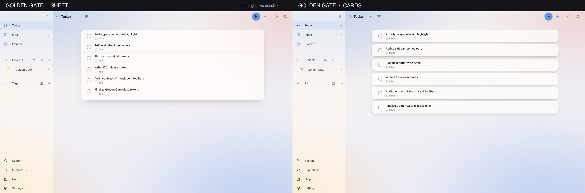

- 纯 CSS，无远程资源、无脚本、无图片依赖
- 亮色 / 暗色 / 跟随系统
- 通过 Super Productivity 自带的 **Settings → General → Theme → Install theme…** 安装
- 已用实际安装器验证：无 token 警告，安装后自动启用

| Sheet 版 | Cards 版 |
| --- | --- |
| 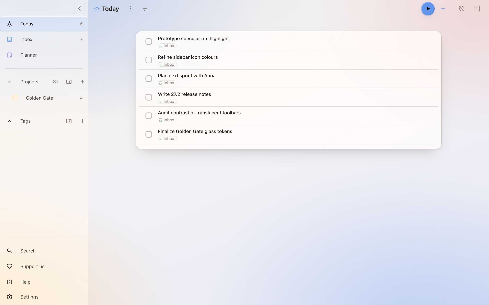 | 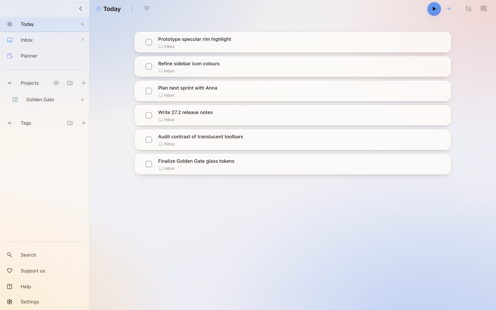 |

## 安装

1. 下载 [`golden-gate.css`](golden-gate.css)（Sheet 版）或 [`golden-gate-cards.css`](golden-gate-cards.css)（Cards 版）。
2. 打开 **Settings → General → Theme**，点 **Install theme…**。
3. 选择对应文件。安装后会立即应用，并出现在主题下拉框中，显示为 **Golden Gate** / **Golden Gate Cards**。
4. 想让主题跟随 macOS 外观，把 **Dark Mode** 设为 **System**。
5. 卸载：在主题下拉框中点该项右侧的删除图标。

> 主题会以文件名作为 id/显示名。想改显示名，把文件重命名后再安装即可（例如 `macOS 27 Golden Gate.css`）。

## 预览

| 亮色 | 暗色 |
| --- | --- |
|  | 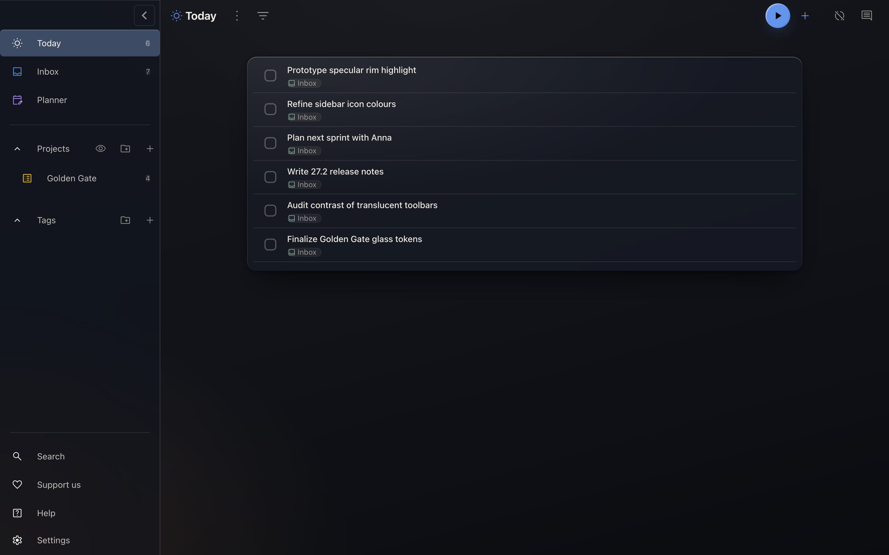 |

| 项目视图（强调色随项目变化） | 对话框 |
| --- | --- |
| 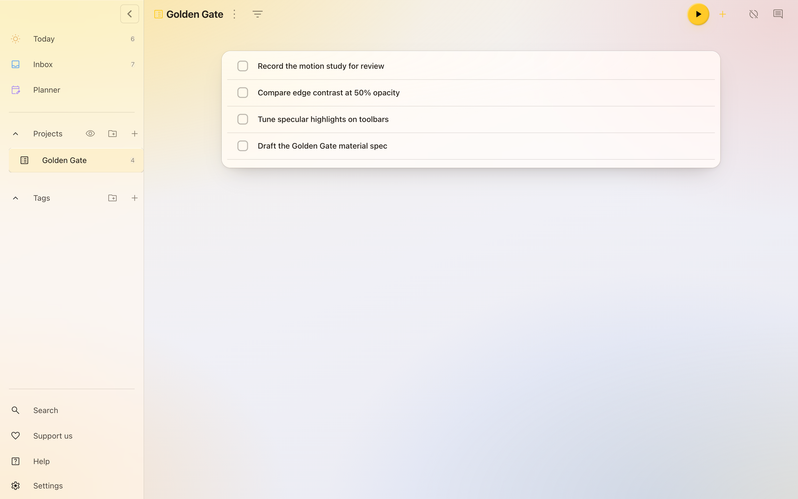 | 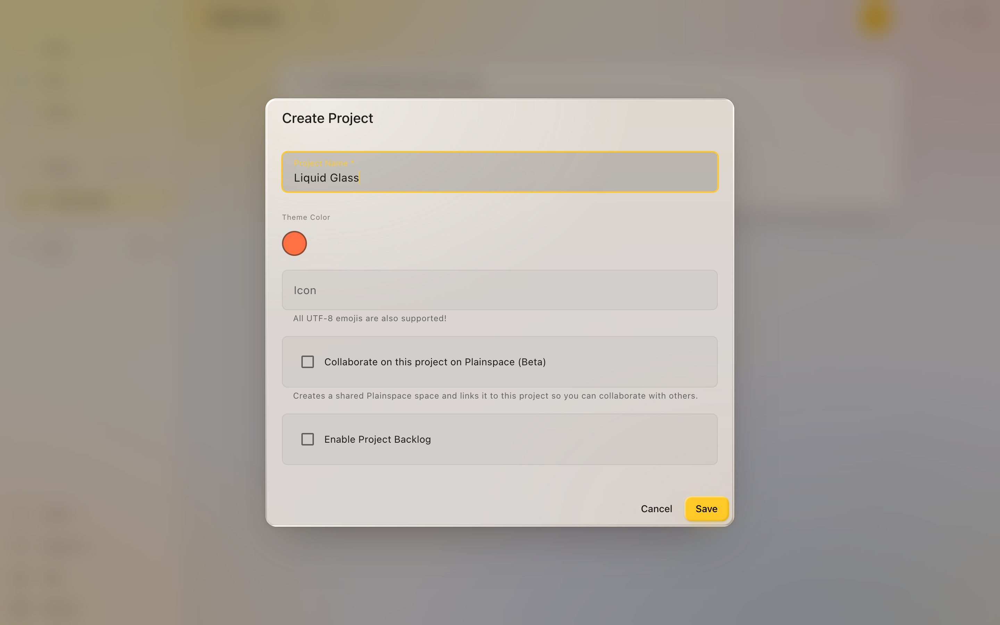 |

| 命令栏 | 移动端 |
| --- | --- |
| 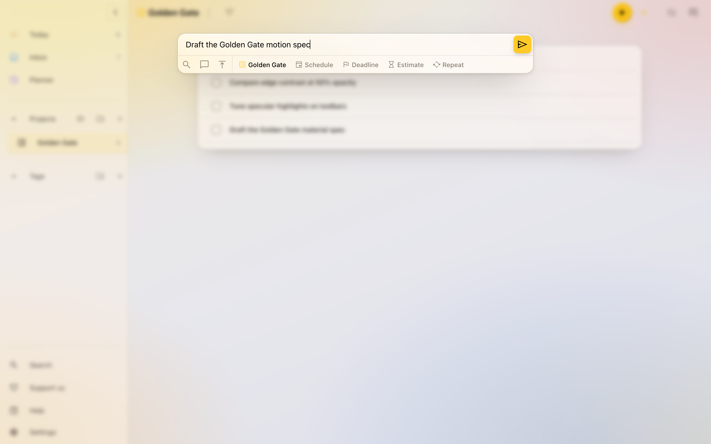 | 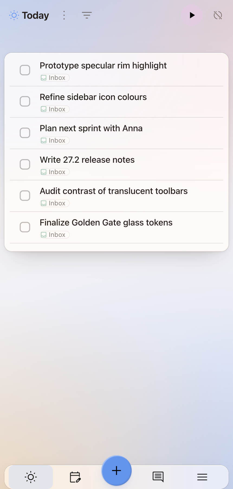 |

动效预览（GIF，约 12 秒）：

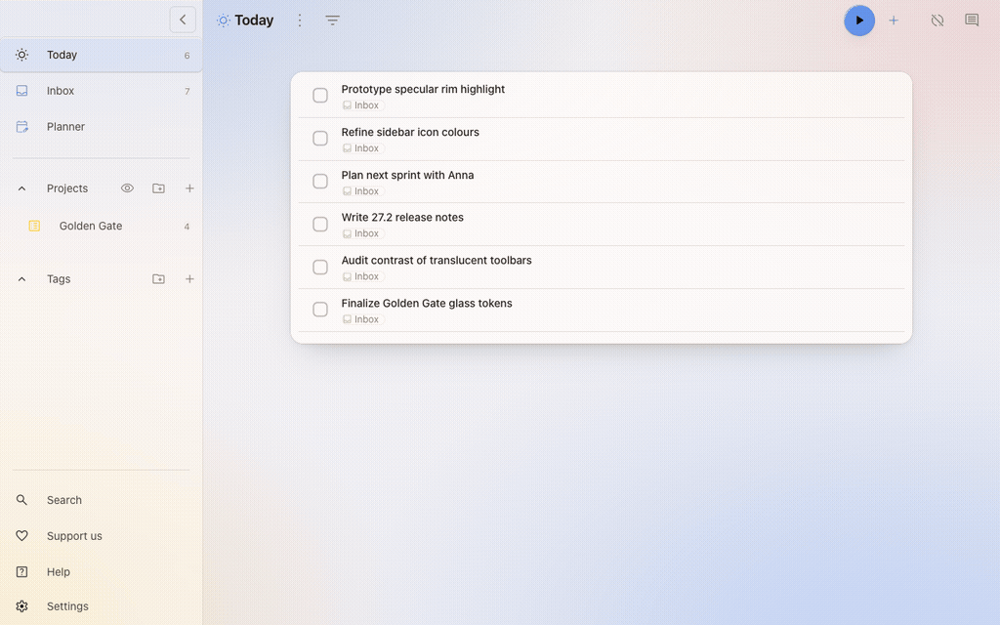

## Cards 版设计

Cards 版不是简单把行间距拉开，而是把“玻璃片”的物理逻辑搬到每一张任务上：

- **16px 卡片 + 10px 间距**：卡片之间露出壁纸，层次由卡片自己建立，而不是由一个大底板建立。
- **独立边缘**：每张卡都有顶部 1.5px 镜面高光、0.5px 暗色外圈、底部暗收边；暗色模式额外加一圈极淡的暖白轮廓，让卡片在近黑背景上仍可辨认。
- **hover 抬升**：整张卡上移 2px，阴影扩大，背景加入 2% 强调色；同时有一条 620ms 的斜向高光扫过。
- **选中 vs 当前**：选中是 1px 强调色细环 + 轻染色；当前任务是 1.5px 强调环 + 34px 柔光 + 更明显的强调色填充，避免两个状态混淆。
- **卡片入场**：380ms 上移 + 0.985 → 1 缩放，前 8 张以 18ms 递增延迟；动画作用在内容 wrapper 上，不覆盖 CDK 的拖拽 `transform`。
- **同族卡片**：Planner、笔记、schedule event、`mat-card` 也使用同一套 `--gg-card-edge`，不会出现“任务卡是玻璃、其他卡是塑料”。
- **为什么是单列卡片**：任务顺序、拖拽、Shift 多选和键盘导航都依赖单列 DOM 顺序；卡片只在纵向做层次，不破坏这些操作。


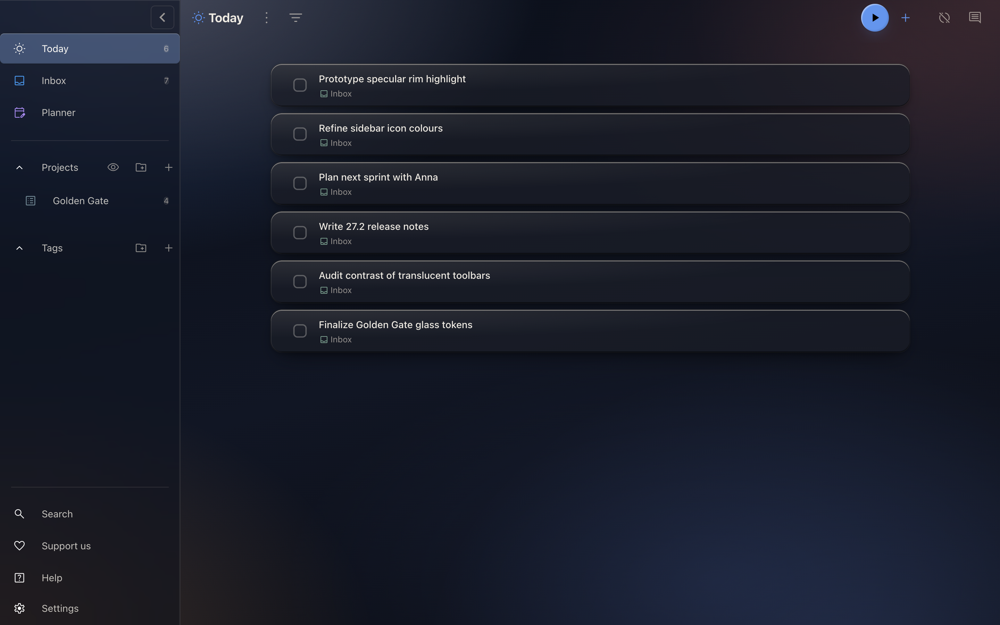

| 选中 / 当前 / hover | 项目视图 |
| --- | --- |
| 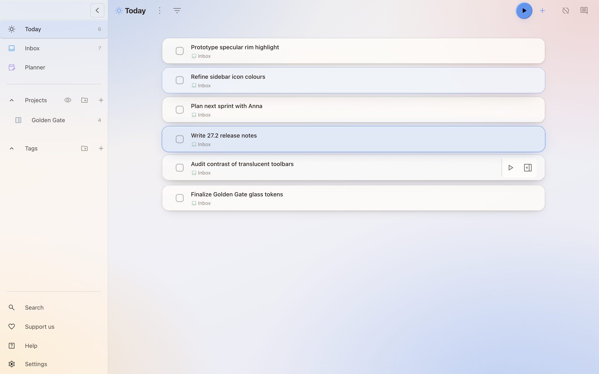 | 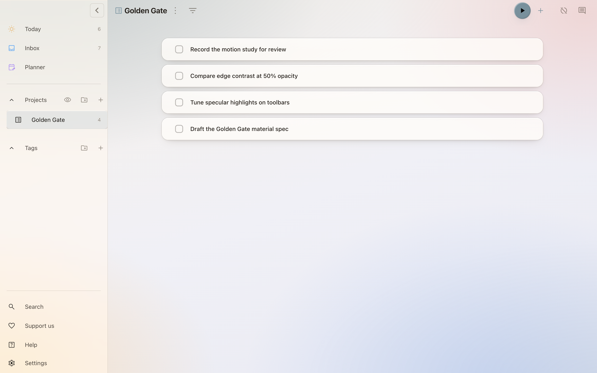 |

| 对话框 | 移动端 |
| --- | --- |
| 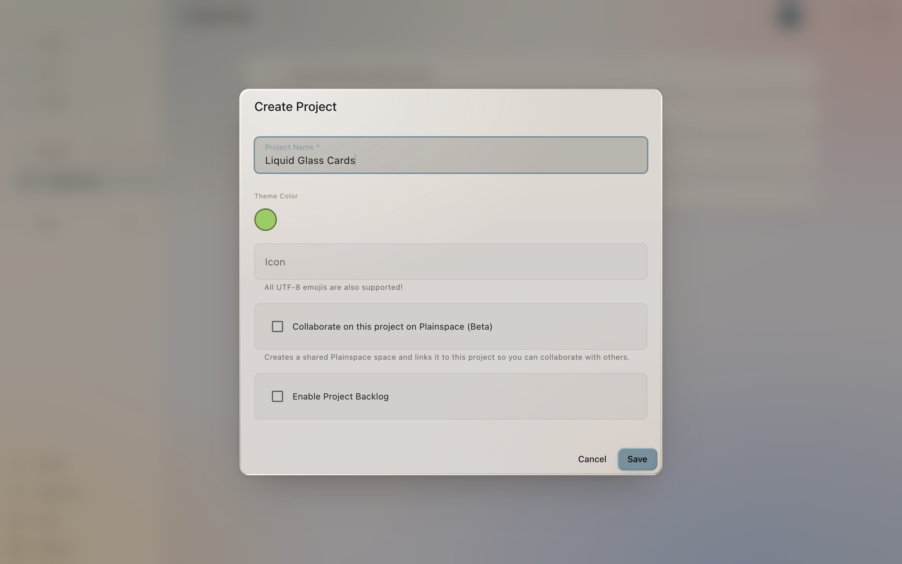 | 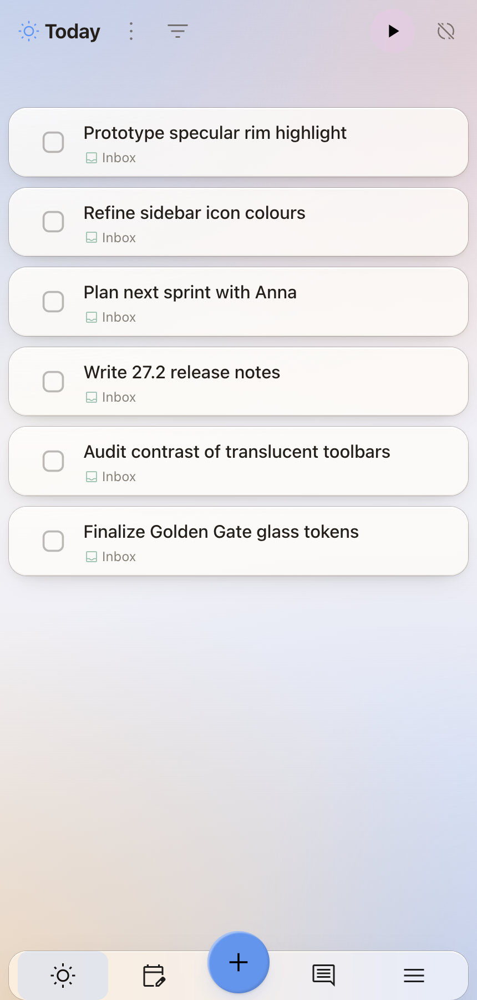 |

## 它如何对应 macOS 27 的变化

Apple 在 WWDC26 对 Liquid Glass 的调整主要集中在可读性和层次，而不是继续加透明度：

| macOS 27 的变化 | 主题里的实现 |
| --- | --- |
| 更好地扩散复杂内容，提升可读性 | 大面板 `blur(28px)`，浮层 `blur(46px)`，配合 `saturate(185%)` 和更高的玻璃填充不透明度；Sheet 版用一整块玻璃，Cards 版每张卡是一片独立玻璃 |
| 暗色边缘 + 更亮镜面高光 | 每个玻璃面都有 0.5px 暗色外圈、顶部 1px 高光、对角的次级高光，以及底部暗收边；对话框额外用渐变描边 |
| 透明度滑块 | 私有变量 `--gg-clarity`（0–1）统一驱动所有填充透明度，默认 `0.55` 是“中间偏一点磨砂”的 macOS 27 默认感 |
| 边到边侧栏，图标恢复彩色 | 侧栏不再悬浮/不再有外投影；Today / Inbox / Planner 图标分别使用金、蓝、紫，项目仍使用项目色 |
| 统一的工具栏与滚动边缘效果 | 顶部工具栏静止时透明；内容滚到其下方时（`.isNotScrolled` 移除）自动结霜、出现发丝分隔线 |
| 更一致、更收敛的窗口圆角 | 10 / 12 / 16px 三档，替代 Tahoe 常见的 20–22px |
| HDR 式层次 | 金/玫瑰/蓝三组环境光叠加在用户强调色上；暗色模式用深墨蓝而不是纯黑，保留高光层次 |

主题的环境色会跟随当前项目的强调色：金色项目会让桌面变成金色黄昏，蓝色/青色项目则变成冷调玻璃；同一套材质只换光，不换结构。

## 动效

动效不是装饰层，而是“玻璃有质量”的表达：

- **环境极光**：`body::before` 做 32 秒的缓慢漂移，是主题唯一的常驻环境动画；其余动效都只响应输入（播放按钮的跟踪脉冲沿用应用自身的逻辑，只改了颜色和柔化）。
- **任务面板入场**（Sheet）：淡入 + 轻微上移 + 0.996 → 1 的缩放。
- **任务行瀑布**（Sheet）：前 8 行以 18ms 递增延迟入场；动画作用在 `.box` 上，不碰 CDK 拖拽使用的 `transform`。
- **卡片瀑布**（Cards）：380ms 上移 + 0.985 → 1 缩放，前 8 张以 18ms 递增延迟；动画作用在内容 wrapper 上，同样不碰拖拽 `transform`。
- **卡片 hover**（Cards）：整卡抬升 2px、阴影扩散、2% 强调色提亮，并有一条 620ms 的斜向高光扫过。
- **侧栏选中态**：药丸形高光会有一个很轻的弹性回弹。
- **按钮**：按压 `scale(0.982)`；主按钮/悬浮按钮有一条 620ms 的高光扫过。
- **浮层**：对话框、菜单、命令栏、移动端底栏分别用 200–360ms 的弹簧曲线进入。
- **滚动边缘**：工具栏从透明到磨砂是 420ms 的交叉过渡。
- **减少动态效果**：`prefers-reduced-motion: reduce` 下关闭极光、瀑布和弹簧位移动画，保留颜色/透明度反馈。

## 调参

主题顶部只有一个真正需要调的旋钮：

```css
:root {
  --gg-clarity: 0.55;
}
```

- `0.30` — 更接近“清透玻璃”，背景纹理更明显
- `0.55` — 默认，macOS 27 的中档磨砂
- `0.80` — 更不透明、优先可读性

其他常用变量：

```css
--gg-blur: 30px;        /* 大面板模糊半径 */
--gg-blur-strong: 46px; /* 对话框/菜单/命令栏 */
--gg-saturate: 185%;    /* 玻璃对背景色的提纯 */
--gg-gold: #e7b267;     /* 环境金色，可换成你喜欢的暖色 */
--gg-r-xl: 16px;        /* 面板/对话框圆角 */
```

改完重新安装一次 CSS 即可。`--gg-clarity` 用 `calc()` 进入 `rgb()` 的 alpha 通道，现代 Chromium/Electron 支持。

## 作为内置主题（可选）

如果想把两个版本随项目一起发布，而不是让用户手动安装：

1. 把两个 CSS 复制到 `src/assets/themes/`。
2. 在 `src/app/core/theme/custom-theme.service.ts` 的内置主题列表中加入：

```ts
{
  id: 'golden-gate',
  name: 'Golden Gate (macOS 27)',
  kind: 'builtin',
  url: 'assets/themes/golden-gate.css',
  requiredMode: 'system',
},
{
  id: 'golden-gate-cards',
  name: 'Golden Gate Cards (macOS 27)',
  kind: 'builtin',
  url: 'assets/themes/golden-gate-cards.css',
  requiredMode: 'system',
},
```

3. 运行 `npm start` 验证。内置主题可以加载资源，但两个版本都刻意不依赖任何资源，方便同时作为可安装主题分发。

## 技术说明与限制

- **不是物理折射。** 真正的液态玻璃需要逐像素位移（SVG `feDisplacementMap` 或 WebGL shader）。Super Productivity 的自定义主题安装器会拒绝所有 `url()`、`data:`、相对资源和 `@import`，所以可安装主题只能做“磨砂 + 高光 + 暗边”的 CSS 近似。这也是网上大多数 CSS Liquid Glass 实现的实际边界：`backdrop-filter` 能得到毛玻璃，但得不到镜头式弯折。
- Sheet 版把 blur 集中在少数大表面上（侧栏、任务面板、工具栏、浮层、移动底栏），任务行、chip、按钮内部不再各自开 blur，避免长列表里每行一个合成层。
- Cards 版在纯渐变壁纸上不逐卡开 blur；只有用户设置了背景照片（`body.hasBgImage`）时才给卡片加 `blur(18px)`，兼顾玻璃感和滚动性能。
- `backdrop-filter` 需要 Chromium/Electron；`@supports` 回退为不透明暖白/深墨表面。
- 支持 `prefers-reduced-transparency: reduce`（改为实色）和 `prefers-contrast: more`（更强的边缘/分隔线）。
- 主题只改表现，不碰任务数据；所有颜色都从主题 token 派生，项目色/用户强调色仍然生效。

## 验证记录

在安装版 **Super Productivity 20.0.0** 的 Web 构建（Chrome 157）中：

- 两个版本都通过应用内 `Install theme…` 上传安装，自动启用，无契约警告
- Sheet 版：亮色/暗色 Today、项目视图、Planner、Settings、对话框、菜单、命令栏、滚动结霜
- Cards 版：亮色/暗色 Today、项目视图、卡片 hover、选中/当前状态、对话框、命令栏、430 × 900 移动端
- 拖拽相关：Sheet 版行动画在 `.box`，Cards 版在内容 wrapper，都不覆盖 CDK 拖拽的 `transform`

## 参考

- [MacRumors — All the Liquid Glass Changes in macOS Golden Gate](https://www.macrumors.com/2026/06/09/macos-golden-gate-liquid-glass/)
- [MacRumors — Here's How Liquid Glass Is Changing in iOS 27](https://www.macrumors.com/2026/06/10/how-liquid-glass-is-changing-in-ios-27/)
- [The Verge — Apple dials down Liquid Glass, and the Mac looks way better for it](https://www.theverge.com/tech/946567/apple-macos-27-golden-gate-dev-beta-hands-on)
- [Apple — Platforms State of the Union, WWDC26](https://developer.apple.com/videos/play/wwdc2026/102/)
- [HTML-in-Canvas — Recreate Apple's Liquid Glass Effect on the Web](https://html-in-canvas.dev/liquid-glass-effect/)
- [Super Productivity — Theming contract](https://github.com/super-productivity/super-productivity/blob/master/docs/theming-contract.md)
- [Super Productivity — Theming wiki](https://github.com/super-productivity/super-productivity/blob/master/docs/wiki/3.09-Theming.md)
